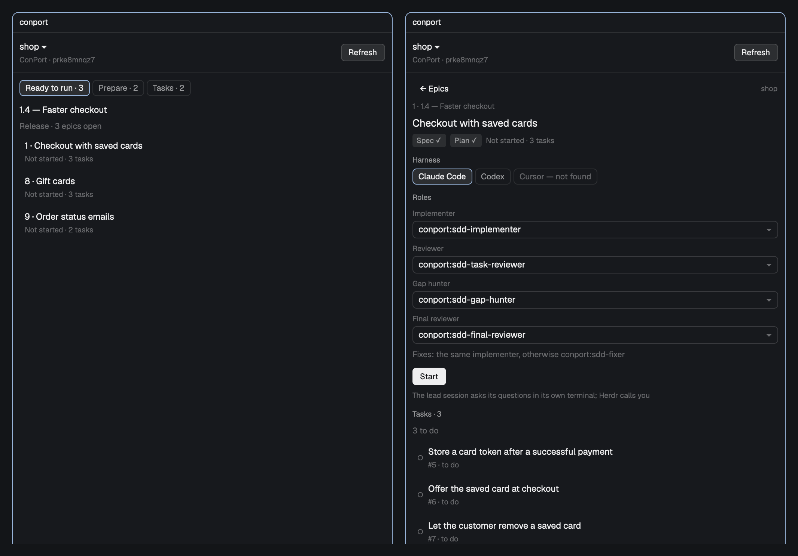

# ConPort

A panel on the right of the window that runs the epics and the tasks of a
[ConPort](https://conport.app) project from Herdr. You pick a project — a git
repository one of your spaces stands in — and see three tabs: the epics ready to
start, the epics to prepare, and the tasks outside the epics. The screen of an
epic picks its harness (Claude Code, Codex or Cursor) and the subagent type of
each of its four roles, then **Start** opens a space `epic-<N>` on a working
copy of the epic with the harness leading the epic in its tab `lead`. A sheet
hands a preparation or a task to an agent in a tab of the project. The agents ask
their questions in their own terminals, and Herdr calls you when one is blocked.
The panel's words are quoted here as the mod shows them.

## What you see

The panel is a column the full height of the window, 320px wide on the right
(`mod.json`: `"place": "right"`), on the theme's `surface` color, text 13px in
`foreground`. Top to bottom:

1. **Header**, 10px padding. On the left the chosen project's name in semibold
   with `▾` (`▴` while open) and, under it in 11px `dim`, `ConPort · <handle>`
   — or `No project chosen`, `No ConPort project`, `Loading the ConPort project…`.
   On the right the button **Refresh**. A click on the name opens the project
   picker under it: a search field `Find project`, one row per project (name,
   and its folder with the home folder as `~`, `· in focus` for the project of
   the focused space; the chosen one on `selected`), then the folders without
   git greyed out with `Folder without git — nothing to run` (whatever language
   git refused in, when neither the folder nor one above it holds `.git`; a
   folder git failed on otherwise, with
   `git failed (<first line of the error>): ConPort settings were not read`:
   it names no project), and, when the binding is the mod's own,
   **Change ConPort project**.
2. A 1px rule in `border`.
3. **Body**, scrolling, 10px padding, 10px between parts:
   - a refusal, when there is one: a box with a 1px `blocked` border and
     `blocked` text, one line of what is wrong ` — ` one action that ends
     with a period;
   - a notice after a start or a hand-off: a box with an `accent` border;
   - what the repository's ConPort settings files tell, when they tell
     anything: a card `ConPort settings` with one line each, as the conport
     plugin words them (`.conport.json is not valid JSON (line 3, column 1): fix it`);
     a settings file that is there but broken names no project, and the body
     ends with this card;
   - **no ConPort project** for the repository: a card `ConPort project` with
     `The repository has no ConPort project — enter the project's name or handle.`,
     the `dim` line
     `The repository has no .conport.json with project_name. The mod remembers the project for this repository.`
     (for a submodule or a worktree of a bare repository
     `This repository is a submodule or a worktree of a bare repository: ConPort settings files are not read here. Bind a project below.`),
     a field `name or handle` and **Remember**;
   - **the tabs**: three chips 24px high, `Ready to run · <n>`,
     `Prepare · <n>`, `Tasks · <n>`, the chosen one with an `accent` border
     on `selected`;
     - **Ready to run**: the epics with a spec and a plan, grouped under their
       milestone's title in semibold (`No milestone` last); a release milestone
       has a `dim` line `Release · 2 epics open` or `Release · ready to close`.
       Each epic is a row `<N> · <title>` with a line under it:
       `Not started · 4 tasks`, `In progress · 2 of 5 closed`, or
       `Ready to merge · 5 of 5 closed` in the theme's `done` color;
     - **Prepare**: a `dim` hint, then the epics without a spec
       (`No spec`, button **Prepare**) or without a plan
       (`Spec, no plan`, button **Write plan**); one that
       preparation cannot fix is greyed out without a button;
     - **Tasks**: the open tasks outside the epics in three groups,
       `In review` (button **Review**), `In progress` (button **Fix** on
       a task the review sent back, `Changes requested`) and
       `To do` by priority (`High · not started`, button
       **Hand to agent**); a bug's line starts with `Bug · `;
   - **the screen of an epic**, instead of the tabs: **← Epics** and the
     project's name; `<N> · <milestone>` in 11px `dim`; the title in 15px
     semibold; badges `Spec ✓`, `Plan ✓` and where the epic stands. Then
     `Harness` with three chips (`Claude Code`, `Codex`, `Cursor`; one not
     installed greyed out as `Codex — not found`), `Roles` with four fields
     whose options open under them on `popover` — `Implementer`, `Reviewer`,
     `Gap hunter`, `Final reviewer` — and the line
     `Fixes: the same implementer, otherwise conport:sdd-fixer`. Then the buttons and
     11px `dim` lines under them, and `Tasks · <n>` with the counts
     (`to do 1 · in progress 1 · in review 0 · blocked 0 · done 3`,
     `parked` only when not zero) and every task of the epic, its status on the
     right, a closed one in `done`, a cancelled one dimmed at the end;
   - **a sheet**, instead of the tabs: a card with `Prepare “<title>”` (or
     `Write plan`, `Hand to agent`, `Review`, `Fix`), what the agent
     will do in three numbered steps (numbers in `accent`), a chip per installed
     agent (`· last time` on the one of last time), **Cancel** and the
     button of the sheet.
4. A 1px rule, then the footer in 11px `dim`: `mod <version> · CLI <CLI_VERSION>` —
   `version` of `mods/conport/mod.json` and `CLI_VERSION` of
   `mods/conport/version.js`.

Buttons are 26px high, 6px corners: the main one on `solid` with
`solid_foreground` text, the others on `raised`, a quiet one on `surface`. Every
color is a token of `theme()`: the panel follows the person's theme.

## How it behaves

- **Reading.** On open and on **Refresh** the mod reads the spaces of this
  machine, the git directory of each of their folders, the agents Herdr can
  start, then the project's epics and tasks through the ConPort CLI. An epic's
  working copy, its tasks and the subagent types of its harness are read when
  the epic is opened. Nothing is read on a timer; Herdr redraws the panel when
  `spaces()`, `panes()` or `agents()` change.
- **Projects.** Every space of this machine (`machine === null`) gives the
  folders of its panes; folders of one repository — its main checkout and its
  worktrees, `~/.herdr/worktrees/` included — merge into one project by their
  absolute git directory. The project of the focused space is chosen first,
  else the last chosen. Its ConPort project is `project_name` of
  `.conport.json` in the main checkout, `.conport.local.json` beside it
  overriding it (the rules of the conport plugin, held by its examples), else
  `env.CONPORT_PROJECT_NAME` of the old place `.claude/settings.local.json`,
  else the handle or name the person typed, kept by the mod for that
  repository. A submodule or a bare repository has no main checkout and only
  the kept handle.
- **Starting an epic.** **Start** first checks everything that can refuse —
  the harness is installed, the repository's checkouts and the branches of the
  epic, and the task the CLI writes for the lead session — and only then makes a
  working copy `~/.herdr/worktrees/<repo>/epic-<N>` on the branch `epic-<N>` (or
  takes the copy or the branch already there; the base is the branch of the
  main checkout) and opens the harness there: `space.new` named `epic-<N>` with
  its tab `lead`, or a tab `lead` in the space the epic already has. The task is
  the harness's start argument. While the agent appears, **Start** is off
  with `The agent is opening in space epic-<N>`; the agent's appearance,
  **Refresh** or one minute ends it (after a minute with
  `The agent did not appear — look at the lead tab of space epic-<N>.`).
- **A live session.** A terminal whose pane stands in the epic's copy and runs
  the harness — in `agents()` with any status, or a harness pane not reporting a
  status yet (Claude Code waiting on the folder trust question) — is the epic's
  session. Then the buttons are **Show tab** (`space.select` of its space) and
  **Start again**, which asks first (`Start epic <N> again?`, **Yes, start**)
  and opens one more tab `lead`. A pane where the agent quit by itself (a login
  shell now) is no session: the epic shows **Start** with
  `The working copy is already there: the agent resumes where the work stopped`.
  Under the buttons: `If a session in Orca runs this epic, do not start a second one`
  once the copy exists, and always
  `The lead session asks its questions in its own terminal; Herdr calls you`.
- **Agent statuses.** The panel does not draw them: `working`, `blocked`,
  `idle` and `done` show in Herdr itself, which calls the person when the lead
  session is blocked or done. A status of any kind only tells the mod that the
  session is live.
- **Sheets.** **Prepare**, **Write plan**, **Hand to agent**,
  **Review** and **Fix** open a sheet; its button opens the chosen
  agent with its task in a tab `prepare-<N>` or `task-<id>` of the space whose
  pane stands in the main checkout, or a new space there. The notice says where
  it opened and when to press **Refresh**.
- **Remembered.** Per repository: the harness and the four role types of each
  started epic, the harness of the last start, the agent of the last sheet and
  the project binding, in Herdr's shared state under keys starting with
  `conport:`. Per copy of the mod (`localStorage`): the tab, the project and the
  open epic. A choice not started lives until the mod closes.
- **Refusals.** One line each, what is wrong and one action:
  `npx is not found in Herdr's environment — install Node 18+ and press Refresh.`,
  `No ConPort API key — add CONPORT_API_KEY to ~/.config/conport/.env and press Refresh.`,
  `The ConPort CLI did not answer in 300 s — check the network and press Refresh.`, a
  failed `git worktree add` with git's text and
  `remove the unfinished copy with git worktree remove --force <copy> and try again.`,
  any other failed git command or CLI run with its text and `press Refresh.`,
  and the CLI's refusals by their code; any other comes as it is, and with
  `press Refresh.` when it has no action of its own.
- Hover lightens a row or a chip to `hover`; a disabled button is at 45%.
  There are no keys of its own.

## Built from

- `mods/conport/`: `main.js` (the `View`: reading, choices, actions, drawing),
  `ui.js` (buttons, chips, rows, a field with options, cards, in theme colors),
  and modules without gpui-kit, tested outside Herdr: `cli.js` (the CLI and its
  answers), `git.js` (checkouts, branches, the copy's path), `projects.js`,
  `harness.js` (the three harnesses from `knownAgents()`), `session.js` (the
  live session, the space a start uses, the wait after a start), `launch.js`
  (the start of an epic, a sheet's hand-off), `screen.js` (the words),
  `refusals.js`, `state.js` (shared state keys), `version.js` (`MOD_VERSION`,
  `CLI_VERSION`); `mod.json` `{"place": "right", "version": "<version>"}`.
- `gpui-kit` (`div`, `View`) and `gpui-base` (`h_flex`, `v_flex`, `Input`,
  `InputState`, `Scrollbar`).
- `herdr`: `spaces`, `panes`, `agents`, `focused`, `knownAgents`, `home`,
  `theme`, `exec`, `run`, `shared`, `setShared`, `readTextFile`; `cx.spawn`,
  `cx.timer.after`, `localStorage`.
- Commands: `space.new {name, folder, tab, argv, machine: ""}`,
  `tab.new {space, name, folder, argv}`, `space.select {id}`.
- Programs, through `exec`: `npx -y conport@<CLI_VERSION> …` (timeout 300 s) —
  `epic list`, `task list`, `epic subagents`, `api tasks list` and
  `prompt epic|prepare|task`, which reach the ConPort service over the network
  with the key the CLI reads itself; `git` — `worktree list --porcelain`,
  `for-each-ref`, `rev-parse --path-format=absolute --git-common-dir`,
  `worktree add` (timeout 600 s), and, only when `.conport.local.json` is
  there, `ls-files --error-unmatch` and `check-ignore -q` of it (timeout 5 s
  each); `printenv XDG_CONFIG_HOME` (timeout 5 s), since a mod has no
  environment of its own. It reads `.conport.json`, `.conport.local.json` and
  `.claude/settings.local.json` of the repository's main checkout, and
  `conport/.env` in `$XDG_CONFIG_HOME` (else `~/.config`) only to tell whether
  it sets `CONPORT_PROJECT_NAME`. `readTextFile` answers null for a file that
  is not there and rejects with `… (os error N)` for one it cannot read (a
  folder: 21, no permission: 13); the mod names that `EISDIR`, `EACCES`, else
  `EIO`, and takes `ENOENT` (2) and `ENOTDIR` (20) as a file that is not
  there. No art.

## Watch out

- The mod runs programs and reaches the network: tell the person before adding
  it. It never uses, shows or sends the ConPort API key; the CLI reads it from
  its environment or `~/.config/conport/.env`.
- Pass an agent's task as the last element of `argv`, never in `task`: Herdr
  drops the first message of an agent not ready within 60 seconds, and Claude
  Code in a new folder first asks whether to trust it.
- Claude Code waiting on the trust question reports no status: it is in
  `panes()` (`program.key` `claude`), not in `agents()`. Count it as the live
  session, or a second start opens a second agent in the same copy.
- After an agent quits by itself its pane stays `live` as a login shell
  (`program.key` `shell`): that is no session.
- A space's place is its panes' live folders, not the folder it was made in;
  find the epic's session by a pane inside the copy, under any space name.
- `exec` defaults to 30 seconds; the first `npx` download takes longer.
- `tab.new` without `folder` opens in the focused terminal's folder: always
  pass it.
- `herdr-app check` writes `gpui-kit.d.ts`, `herdr.d.ts` and `jsconfig.json`
  into the mod folder: they are not part of the mod.
- `herdr-app check` does not read `version` in `mod.json`; the mod keeps a copy
  in `version.js` for its footer.
- Copy the mod folder whole, `mod.json` no later than `main.js`: a folder whose
  `main.js` came first is placed as a 320px panel on the right regardless.
- Limits: only spaces of this machine; no way to run an epic by the `/conport:epic` workflow (that is in
  Orca); no run progress, questions or stop in the panel — close the agent's
  tab to stop it.
- It assumes `npx` (Node 18+), `git`, a ConPort API key, and Claude Code,
  Codex or Cursor installed; Claude Code needs the conport plugin for the
  default subagent types.

## Done when

- `herdr-app check ~/.config/herdr-app/mods/conport` passes.
- The panel opens on the right with the project of the focused space and its
  three tabs with counts; the footer shows the mod and CLI versions.
- A repository whose `.conport.json` has `project_name` lists that project's
  epics and tasks; one without it (and without `CONPORT_PROJECT_NAME` in the
  old place) asks for a handle; after **Remember** its epics and tasks are
  listed.
- Opening an epic shows its harness chips, four role fields filled with the
  `conport:sdd-*` types, and its tasks with counts.
- **Start** opens a space `epic-<N>` with a tab `lead` in
  `~/.herdr/worktrees/<repo>/epic-<N>` running the harness with the task, and
  the button turns into **Show tab** and **Start again** once the agent
  is seen.
- Closing that tab brings **Start** back with the note that the copy is
  there; starting again opens a tab `lead` in the same space.
- **Hand to agent** on a task opens a tab `task-<id>` in the project's space
  with the chosen agent and its task.
- Without `npx` in Herdr's environment the panel shows the `npx` line, not an
  empty list.

## Install

Checked on Herdr app 0.1.15; earlier versions are not supported. Copy
`mods/conport/` into `~/.config/herdr-app/mods/` (the folder whole, as it is),
then run `herdr-app check ~/.config/herdr-app/mods/conport`. If the name
`conport` is taken, rename the new folder.

## Update

Herdr's install does not overwrite a taken name. With the person's consent,
delete `~/.config/herdr-app/mods/conport`, copy the new `mods/conport/` in its
place and run `herdr-app check ~/.config/herdr-app/mods/conport`. What the mod
remembers lives in Herdr's shared state and survives the update.
